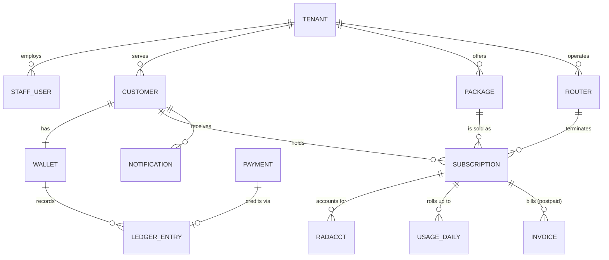

# 03 · Domain model

Entities below are grouped by the module that owns them. Every tenant-scoped table carries `tenant_id`; IDs are UUIDv7; money is stored as integer minor units (KES cents) with a currency code; timestamps are `timestamptz` in UTC.

## Relationships

## tenancy

**tenant**

| Field | Notes |
|---|---|
| `id`, `code` | `code` is a short unique prefix used in customer numbers, e.g. `CB` |
| `name`, `subdomain`, `logo_url`, `brand_colour` | Branding for portal and SMS |
| `timezone` | Default `Africa/Nairobi`; used for day boundaries and display |
| `default_grace_days`, `partial_payment_rule`, `grace_mode` | `partial_payment_rule`: `WAIT_FOR_FULL` or `PRO_RATA_DAYS`; `grace_mode`: `FULL_SPEED` or `THROTTLED` |
| `sms_sender_id` | Registered with the SMS provider |
| `status` | `TRIAL`, `ACTIVE`, `SUSPENDED` |

**tenant_secret** — `tenant_id`, `kind` (`MPESA_CONSUMER_KEY`, `MPESA_CONSUMER_SECRET`, `MPESA_PASSKEY`, `MPESA_SHORTCODE`, `SMS_API_KEY`, …), `ciphertext`, `key_version`. Envelope-encrypted, never returned by the API after entry.

## identity

**staff_user** — `tenant_id` (null for Corebalt platform admins), `email`, `phone`, `password_hash`, `totp_secret`, `role_id`, `status`, `last_login_at`.

**role** and **permission** — roles are per tenant; permissions are fixed codes such as `customers.write`, `payments.record_manual`, `network.coa`, `settings.secrets`.

**audit_log** — `tenant_id`, `actor_type` (`STAFF`, `CUSTOMER`, `SYSTEM`), `actor_id`, `action`, `entity_type`, `entity_id`, `before` (jsonb), `after` (jsonb), `ip`, `at`. Append-only.

## customers

**customer**

| Field | Notes |
|---|---|
| `number` | Tenant code plus zero-padded sequence, e.g. `CB001238`; unique across the platform; used as the M-Pesa account reference |
| `name`, `phone` (E.164), `email`, `national_id` (encrypted, optional) | |
| `address`, `installation_location` (text), `lat`, `lng` | |
| `legacy_account_ref` | The M-Pesa account reference the customer used in the ISP's old system, kept by the cutover import ([ADR 0014](adr/0014-cutover-import-with-current-expiry.md)); upper-cased, unique per tenant, matched exactly before normalisation (P3); cleared by staff once forgotten |
| `status` | `ACTIVE`, `ARCHIVED` |
| `portal_pin_hash` | Portal login by phone number and PIN, or OTP by SMS |

## packages

**package**

| Field | Notes |
|---|---|
| `name`, `type` | `PPPOE` or `HOTSPOT` |
| `download_kbps`, `upload_kbps` | Becomes `Mikrotik-Rate-Limit` as `upload/download`, e.g. `5M/10M` |
| `duration_minutes` | 30 days = 43200; hotspot plans use hours |
| `price_minor` | KES cents |
| `grace_days` | Overrides the tenant default when set |
| `data_cap_bytes`, `fup_bytes`, `throttle_download_kbps`, `throttle_upload_kbps` | Null means unlimited. Bytes are download plus upload in one cycle; past `fup_bytes` the line runs at the throttle speeds, past `data_cap_bytes` it is restricted, until it renews ([04](04-subscription-lifecycle.md) Fair use) |
| `device_limit` | Enforced on hotspot only (shared users); PPPoE cannot see devices behind the customer's router |
| `billing_mode` | `PREPAID` or `POSTPAID` |
| `active` | Inactive packages stay attached to existing subscriptions but cannot be sold |

## subscriptions

**subscription** — the service line. A customer may hold more than one.

| Field | Notes |
|---|---|
| `customer_id`, `package_id`, `router_id` | |
| `pppoe_username`, `username_kept` | Equals `customer.number` for the first line, `CB001238-2` for a second line; or, when `username_kept`, the name the cutover import kept from the old system: unique within the tenant, never in the generated shape, correctable while the cutover window is open (T2, [ADR 0014](adr/0014-cutover-import-with-current-expiry.md)) |
| PPPoE password | Not a column here: platform-generated, stored in `network_radius_credential` (owned by `network`), shown once to staff at creation, then only regenerated ([ADR 0009](adr/0009-radius-credentials-readable-only-by-radius.md)) |
| `static_ip`, `mac_address` | Optional |
| `state` | Stored: `PENDING`, `ACTIVE`, `PAUSED`, `SUSPENDED`, `TERMINATED` (see [04](04-subscription-lifecycle.md)) |
| `expires_at` | The date the paid period ends |
| `grace_days`, `grace_mode` | Copied from package or tenant at renewal so a later policy change does not alter a running cycle (S6); `grace_mode` is null on lines renewed before it was kept, which follow the tenant's |
| `paused_at`, `pause_until` | Clock freeze for customer-requested pause |
| `billing_day` | Postpaid only |
| `pending_package_id` | Downgrade or deferred upgrade to apply at next renewal |
| `activated_at`, `terminated_at` | |
| `cycle_started_at` | When the current cycle began: the last renewal. Fair-use and data-cap usage count from here; null (lines renewed before fair use existed) means not metered until the next renewal |

Derived, never stored: `display_status` (`EXPIRING`, `GRACE`, `RESTRICTED`, …) and `access_profile` (`FULL`, `THROTTLED`, `RESTRICTED`, `REJECT`).

## billing

**wallet** — one per customer: `customer_id`, `currency`, `balance_minor` (cache of the ledger sum, checked by a nightly job).

**ledger_entry** — append-only.

| Field | Notes |
|---|---|
| `wallet_id`, `type` | `PAYMENT`, `RENEWAL_CHARGE`, `PRORATION_CHARGE`, `POSTPAID_CHARGE`, `ADJUSTMENT`, `CREDIT_NOTE`, `REFUND`, `REVERSAL`, `COMMISSION` (v3) |
| `amount_minor` | Signed: credits positive, charges negative |
| `balance_after_minor` | Running balance at insert time |
| `reference_type`, `reference_id` | The payment, subscription renewal or adjustment that caused it |
| `description`, `created_by`, `created_at` | |

**invoice** (postpaid) — `subscription_id`, `period_start`, `period_end`, `amount_minor`, `status` (`OPEN`, `SETTLED`, `VOID`), `number`.

**receipt** — one per payment: `payment_id`, `number` (per-tenant sequence, never reused), `pdf_key`.

## payments

**payment**

| Field | Notes |
|---|---|
| `channel` | `MPESA_PAYBILL`, `MPESA_STK`, `CASH`, `BANK`, `CARD` |
| `provider_txn_id` | M-Pesa `TransID`; unique per tenant, the idempotency key |
| `account_ref`, `msisdn`, `payer_name` | As received from M-Pesa |
| `amount_minor`, `received_at` | |
| `status` | `MATCHED`, `UNMATCHED`, `REVERSED` |
| `customer_id`, `matched_by`, `matched_at` | Null while unmatched |
| `raw_payload` | jsonb copy of the callback |

**stk_request** — `customer_id`, `amount_minor`, `checkout_request_id`, `status` (`PENDING`, `COMPLETED`, `FAILED`, `TIMED_OUT`), `result_code`, `payment_id`.

**reconciliation_run** — `tenant_id`, `source` (`STATEMENT_CSV`, `TRANSACTION_STATUS`), `period`, `missing_count`, `extra_count`, `report_key`.

## network

**site** — `name`, `lat`, `lng`, `notes`.

**router** (a RADIUS NAS)

| Field | Notes |
|---|---|
| `site_id`, `name`, `model`, `routeros_version`, `identity` | |
| `wg_public_key`, `tunnel_ip_a`, `tunnel_ip_b` | Tunnel addresses on each hub |
| RADIUS secret | Per router, platform-generated, stored in `network_radius_credential` like PPPoE passwords ([ADR 0009](adr/0009-radius-credentials-readable-only-by-radius.md)) |
| `api_username`, `api_password` | Encrypted; REST user limited to read and PPP actions |
| `snmp_community` | Encrypted |
| `status`, `last_seen_at`, `last_handshake_at` | `ONLINE`, `OFFLINE`, `UNKNOWN` |

**ip_pool** — `router_id`, `name`, `cidr`, `purpose` (`FULL`, `RESTRICTED`).

**radius_credential** — `subscription_id` or `router_id`, `secret`. PPPoE passwords and router RADIUS secrets, readable only through the RADIUS views; the application can insert and update `secret` but never select it ([ADR 0009](adr/0009-radius-credentials-readable-only-by-radius.md)).

**radius_client** — a view over `router` giving FreeRADIUS `nasname` (tunnel IP), `secret`, `shortname`, `tenant_id`.

**v_radius_auth** — a view joining `subscription`, `package`, `customer`, `tenant` and `line_usage` that computes, at query time, the `access_profile`, `Mikrotik-Rate-Limit`, `Framed-Pool`, `Mikrotik-Address-List` and `Session-Timeout` for a username. FreeRADIUS reads only this view and `radius_client`.

**radacct** — the standard FreeRADIUS accounting table, partitioned by month on `acctstarttime`, plus `tenant_id` and `subscription_id` filled by a trigger from the username.

**usage_daily** — `subscription_id`, `day` (tenant local date), `bytes_in`, `bytes_out`, `session_seconds`.

**line_usage** — per line: `cycle_started_at`, `octets` (download plus upload in that cycle) and when the fair-use allowance and the data cap were announced. Fed by the same roll-up as `usage_daily`; a row for an older cycle than the line's counts as zero.

## notifications

**notification_template** — `tenant_id`, `event_key` (`EXPIRING_3D`, `EXPIRING_1D`, `DUE_TODAY`, `GRACE_STARTED`, `RESTRICTED`, `PAYMENT_RECEIVED`, `RESTORED`, `PACKAGE_CHANGED`, `ROUTER_OFFLINE`), `channel`, `body` with placeholders such as `{name}`, `{amount}`, `{expires_on}`.

**notification** — `customer_id` or `staff_user_id`, `channel`, `event_key`, `rendered_body`, `status` (`QUEUED`, `SENT`, `DELIVERED`, `FAILED`), `provider_message_id`, `dedupe_key` (e.g. `EXPIRING_3D:<subscription_id>:<expires_at>`), `sent_at`.

## hotspot (v2)

**hotspot_plan** — like `package` with `type = HOTSPOT`, plus `shared_users`.

**voucher** — `batch_id`, `code` (`AF71-KQ82`), `plan_id`, `status` (`UNUSED`, `ACTIVE`, `EXPIRED`, `VOID`), `activated_at`, `expires_at`, `sold_by` (agent, v3).

**hotspot_session** — a hotspot login identified by phone number or voucher, with the `radacct` rows it produced.

## support (v2)

**ticket** — `customer_id`, `category` (`NO_INTERNET`, `SLOW`, `PAYMENT_NOT_REFLECTED`, `RELOCATION`, `UPGRADE`, `OTHER`), `status`, `assignee_id`, `notes`.

**outage** — `site_id` or `router_id`, `started_at`, `resolved_at`, `message` sent to affected customers.

## Enumerations at a glance

| Enum | Values |
|---|---|
| `SubscriptionState` (stored) | `PENDING`, `ACTIVE`, `PAUSED`, `SUSPENDED`, `TERMINATED` |
| `DisplayStatus` (derived) | `PENDING`, `ACTIVE`, `EXPIRING`, `GRACE`, `RESTRICTED`, `PAUSED`, `SUSPENDED`, `TERMINATED` |
| `AccessProfile` (derived) | `FULL`, `THROTTLED`, `RESTRICTED`, `REJECT` |
| `LedgerEntryType` | `PAYMENT`, `RENEWAL_CHARGE`, `PRORATION_CHARGE`, `POSTPAID_CHARGE`, `ADJUSTMENT`, `CREDIT_NOTE`, `REFUND`, `REVERSAL`, `COMMISSION` |
| `PaymentChannel` | `MPESA_PAYBILL`, `MPESA_STK`, `CASH`, `BANK`, `CARD` |
| `PaymentStatus` | `MATCHED`, `UNMATCHED`, `REVERSED` |
| `BillingMode` | `PREPAID`, `POSTPAID` |
| `PartialPaymentRule` | `WAIT_FOR_FULL`, `PRO_RATA_DAYS` |
| `GraceMode` | `FULL_SPEED`, `THROTTLED` |
