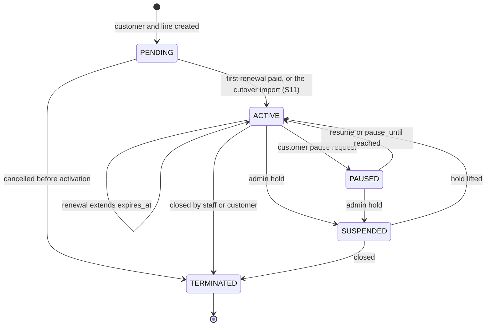

# 04 · Subscription lifecycle

Store only the states people set by hand; derive everything else from dates. RADIUS evaluates the dates itself at every login, so a stuck job can never leave an unpaid user online or a paid user offline.

## States

| State | Stored or derived | Meaning | Access profile |
|---|---|---|---|
| `PENDING` | Stored | Signed up, awaiting installation or first payment | `REJECT` |
| `ACTIVE` | Stored | Service in force; access depends on `expires_at` and grace | see below |
| `EXPIRING` | Derived: `expires_at` within 3 days | Reminder window | `FULL` (a throttled or capped line shows `THROTTLED` or `CAPPED` instead) |
| `GRACE` | Derived: past `expires_at`, inside `grace_days` | Final warnings | `FULL`, or `THROTTLED` when the tenant's `grace_mode` is `THROTTLED` |
| `RESTRICTED` | Derived: past grace | Unpaid | `RESTRICTED`: walled garden with portal and pay page only |
| `THROTTLED` | Derived: before expiry, past the cycle's fair-use allowance (N9) | Renew early to restore full speed; not yet due | `THROTTLED` |
| `CAPPED` | Derived: before the end of grace, the cycle's data cap used up (N9) | Renew to reconnect; counted with restricted lines by staff | `RESTRICTED` |
| `PAUSED` | Stored | Customer-requested pause; the expiry clock is frozen | `RESTRICTED` |
| `SUSPENDED` | Stored | Admin hold for fraud, abuse or equipment recovery | `REJECT` |
| `TERMINATED` | Stored | Account closed | removed from RADIUS |

## Stored-state transitions



Every transition writes an audit row and publishes `SubscriptionStateChanged` with a cause, which the network module turns into a CoA or Disconnect. The cause `AUTO_RESUME_RECORDED` (a job recording a resume the RADIUS view already applied at `pause_until`) needs neither: the customer's session is already on the new profile.

Staff transitions (pause, resume, suspend, lift, terminate, cancel) change access, so the API requires an `Idempotency-Key` on each and replays the original response for a repeated key. Renewal has no endpoint: it happens when money reaches the wallet (or through a wallet adjustment with a reason), charging through the billing module's wallet lock so one payment never renews two lines.

## How access is decided

The access profile is computed from the current time, not stored:

```
if state in (PENDING, SUSPENDED, TERMINATED):      REJECT
elif state == PAUSED:                               RESTRICTED
elif now < expires_at + grace_days and cycle usage >= data_cap_bytes:   RESTRICTED
elif now < expires_at + grace_days and cycle usage >= fup_bytes:        THROTTLED
elif now <  expires_at:                             FULL
elif now <  expires_at + grace_days:                FULL or THROTTLED (tenant grace_mode)
else:                                               RESTRICTED
```

The same logic lives in two places that must agree: the SQL function `subscription_access_v2()`, which the `v_radius_auth_v7` view that FreeRADIUS reads and the staff screens (through `subscription_line_access()` and `v_subscription_status`) use, and the `AccessPolicy` and `DisplayStatus` classes in the `subscriptions` module. A test asserts they return the same profile, next change and display status for the same inputs, usage included.

### Fair use and data caps

- A package may set `fup_bytes` (fair-use allowance) and `data_cap_bytes`; null means unlimited. Usage is download plus upload in the line's **current cycle**, which starts at its last renewal (`cycle_started_at`, written in the renewal transaction; Q12 default). Only a renewal starts a new cycle (Q13 default): a top-up too small to renew, a pause or a package change does not. An upgrade NOW keeps the cycle's usage and applies the new package's limits.
- Past `fup_bytes` the line is `THROTTLED` (the package's throttle speeds, or its normal speed when it has none) until the next renewal; past `data_cap_bytes` it is `RESTRICTED` (walled garden with the pay page, never rejected; Q14 default). Both hold only while the dates still give access; a renewal lifts them the moment it commits, and paying the price renews at once (S5).
- Usage comes from the usage roll-up (every 15 minutes, N7) into a per-line cycle total (`network_line_usage`), so a crossing is applied up to about 20 minutes late. A line whose cycle start is unknown (renewed before this rule existed) is not metered until its next renewal.
- When the roll-up sees a line pass a limit it publishes `UsageThresholdReached` once per line, cycle and kind: the API disconnects the live session so it redials into the new profile (the address list changes, so not a CoA), and the customer gets one SMS (`FAIR_USE_REACHED` or `DATA_CAP_REACHED`; Q15 default, no warning before).

## Enforcement

1. **At login.** FreeRADIUS runs the profile logic inside its SQL query and returns the matching reply attributes (speed, pool, address list).
2. **Session-Timeout.** Every accepted login carries `Session-Timeout` = seconds until the next profile change by the clock (expiry if grace is throttled, otherwise grace end; a fair-use throttle or data cap lasts until a renewal, which disconnects the session), capped at 24 hours. Sessions end on time and log back in under the new profile with no job involved; the cap means a missed CoA self-heals within a day.
3. **CoA for mid-session changes.** Payment, package change, pause, suspension and termination send a CoA or Disconnect to the router immediately. The router re-authenticates the customer and gets the new profile within seconds.
4. **The scheduler** runs reminders, dashboard counts, postpaid charges and the usage roll-up that notices fair-use and data-cap crossings. Access never depends on it: a roll-up outage only delays a throttle, it never cuts anyone off.

## Renewal rules

- A renewal needs wallet balance ≥ package price (or a `PRO_RATA_DAYS` tenant rule, see [05](05-billing-and-payments.md)).
- **Early payment** extends from the current `expires_at`; no days are lost.
- **Lapsed account** (past grace) renews from the moment of payment.
- The clock time of `expires_at` is preserved across renewals, so a customer who activated at 14:30 always expires at 14:30 local time.
- `grace_days` is copied onto the subscription at each renewal so a policy change does not shorten a cycle already paid for.
- A `pending_package_id` is applied at renewal: the new package's price is charged and its speed takes effect.

## Pause

- Only an `ACTIVE` subscription with time remaining can be paused; maximum length is a tenant setting (default 30 days).
- `paused_at` is recorded. On resume, `expires_at += now - paused_at`, so paid days are returned.
- A paused line is `RESTRICTED`, not rejected, so the customer can still reach the portal to resume; its `Session-Timeout` runs to `pause_until`.
- Reaching `pause_until` resumes automatically without waiting for any job: from that instant the RADIUS view (and `AccessPolicy`) evaluate the line as `ACTIVE` with `expires_at + (pause_until - paused_at)`. The hourly job later records the same shift.
- Suspending a paused line first returns the paused days, then suspends.

## Suspension and termination

- `SUSPENDED` is an admin action with a reason; access is `REJECT`; the router drops the session at once. Lifting the hold re-evaluates dates: a subscription that expired during the hold comes back as `RESTRICTED`, not `FULL`.
- `TERMINATED` revokes the PPPoE password (RADIUS rejects it with "Account terminated") and frees the static IP; the customer, ledger and accounting history remain for records and lawful requests. Any wallet balance is settled by refund or credit note.
- **Cancel before activation.** A `PENDING` line that was never paid (the customer changed their mind, the installation fell through) is closed with `POST /api/v1/subscriptions/{id}/cancel`. It needs `customers.write`, a reason and an `Idempotency-Key`; it writes an audit row and publishes `SubscriptionStateChanged` (`PENDING` to `TERMINATED`) like every transition (S9). The PPPoE credential is revoked, so the RADIUS view has nothing for the line. The wallet is untouched: money paid towards the line stays as credit, and a refund takes the normal road. Only a `PENDING` line can be cancelled; an active one is terminated. Nothing cancels a line automatically: the dashboard's action queue lists lines pending for more than 14 days, for staff to chase or cancel (decisions.md 2026-10-21).

## How a line becomes active

A line leaves `PENDING` for `ACTIVE` by exactly one of three causes (S12), kept on the line as `activation_cause` and in its audit row and `SubscriptionStateChanged`:

| Cause | Path | Payment |
|---|---|---|
| `RENEWAL` | the first renewal from the wallet (S5, B5) | yes: the ledger debit |
| `IMPORTED` | the cutover import, within the tenant's open cutover window (S11, below) | collected by the ISP's old system |
| `PROBE` | the platform's `probe-setup` command, for the internal probe tenant only ([ADR 0019](adr/0019-synthetic-radius-login-probe.md)) | none: the probe tenant is Corebalt's own, never an ISP's |

No other path may activate a line. The database refuses an activation without a cause, any change to a recorded cause, and `PROBE` on any tenant but the probe tenant; a test pins the three entry points in code. Resuming a paused line (S7) or lifting a suspension (S8) returns an activated line to `ACTIVE` and is not an activation; cancelling a line before activation (S9) needs no cause.

## The cutover import

One of the two activations that are not a payment, and the only one for an ISP's customers (S11, [ADR 0014](adr/0014-cutover-import-with-current-expiry.md)): an ISP moving existing, paying customers onto the platform imports them with the expiry each one already paid for in the old system, so nobody loses paid days and nobody gets a free cycle.

- The CSV column `paid_until` opens the line `ACTIVE` with that expiry; `cycle_started_at` is one package duration before it, so fair use counts the right cycle (N9); grace is copied as a renewal copies it (S6). A date alone (`2026-11-15`) means the time of day chosen on the import, default 12:00, in the tenant's zone: an expiry in daytime, when customers can pay and staff can help. A past date is allowed: the line is `ACTIVE` and expired, so RADIUS sends the customer to the pay page instead of rejecting them.
- Bounded three ways: `paid_until` at most one package duration ahead; only while the tenant's **cutover window** is open, which a Corebalt platform admin opens for at most 30 days and which closes by itself; only by a holder of `subscriptions.import_active`, a permission of the built-in Owner role alone, with 2FA.
- Previewed first: the import's dry run returns what the file does (lines activating, already expired and ahead; the earliest and latest date; the value of the time granted, pro rata of the package price), warnings when more than a tenth of the dates are in the past or nearly all fall on days 1 to 12 (a swapped DD/MM and MM/DD looks like that), and a confirmation the import must send back for that very file.
- No ledger entry: the old system collected that money, the wallet starts empty. An audit row per activated line and one per batch with the preview's totals; `SubscriptionStateChanged` with cause `IMPORTED`, which no consumer acts on since the line has no session yet. No payment SMS; reminders run as for any line. The first renewal follows S5 from `paid_until`, so the customer's billing day survives the migration.
- The same import keeps the customer's PPPoE username and password from the old system (`pppoe_username`, `pppoe_password`), so their router needs no change (T2 widened, docs/06), and their old M-Pesa account reference (`legacy_account_ref`), which keeps matching their payments (P3, docs/05). A "we've moved" SMS with the new number goes to the batch when staff ask (M1).

## Reminders

Templates and timing are per tenant. Defaults:

| Event key | When | Example |
|---|---|---|
| `EXPIRING_3D` | 3 days before `expires_at` | "Hi Mary, your Home Plus internet expires on 17 Nov. Pay KES 2,500 to Paybill 123456, account CB001238." |
| `EXPIRING_1D` | 1 day before | "Your internet expires tomorrow." |
| `DUE_TODAY` | On `expires_at` | "Your internet of KES 2,500 is due today." |
| `GRACE_STARTED` | At `expires_at` when grace > 0 | "Your internet has expired. You have 2 days before service is restricted." |
| `RESTRICTED` | At grace end | "Your internet is restricted. Pay to restore instantly." |
| `PAYMENT_RECEIVED` (one per payment) | After the renewal the payment caused is decided | "KES 2,500 received (CB-R000123). Home Plus renewed until 17 Nov. Thank you, Mary." Variants below. |
| `RESTORED` | A variant of `PAYMENT_RECEIVED`, not a second SMS | "... renewed until 17 Nov. Internet is back within a minute; if not, restart your router." |

**The payment message.** One SMS per payment (dedupe key: the payment ID), sent after the renewal it caused is decided, so it states the amount, the receipt number and what happened. Variants: renewed ("renewed until 17 Nov"); restored (the same, plus "Internet is back within a minute; if not, restart your router", because it goes out before the router's CoA result is known); first activation; several lines renewed by one payment (each listed with its new expiry); partial (the amount still due and how to pay); credit kept (no line due); postpaid (balance due, once postpaid billing exists). A payment whose reference was not recognised gets a reply only when Daraja sent the payer's number unmasked; it asks the payer to use their customer number. Staff adjustments send no "received" message. Reminders for a line whose wallet already covers the next cycle say it renews automatically.

**Templates and cost.** Every default fits one GSM-7 SMS (160 characters) with realistic values. Tenants may reword any template; the editor shows the rendered sample and the number of SMS parts (GSM-7: 160, then 153 per part; any other character switches to UCS-2: 70, then 67), so a change that doubles the bill is visible. Placeholders come from a fixed list with no secrets (M3). The only messages that carry a secret are fixed and not editable: the portal sign-in code, and a staff member's temporary password when staff choose "send by SMS" (Q11, valid 72 hours, changed at first sign-in, audited); both are logged with the secret masked.

**Delivery (Celcom Africa, ADR 0020).** Each tenant connects its partner ID, API key and registered sender ID. Keys stay encrypted and write-only; the client sends international digits from the stored E.164 recipient using JSON POST, never credentials in a URL.
- Sent: `200` with the matching recipient and a nonempty message ID. This is provider acceptance, not handset delivery.
- Failed for good, never retried, the number flagged for staff: `1003` invalid mobile number.
- The tenant's problem, held and retried hourly while tenant staff and the platform are alerted: `1004` insufficient credit, `1001` sender ID refused, `1006` or HTTP 401/403 credentials refused. The alert clears on the next successful send.
- Anything else (server errors, timeouts): retried after 1, 5 and 30 minutes, then dead-lettered and alerted.
- Delivery is queried with the tenant credentials and the stored Celcom message ID, without resending. The live-verified matching message-id, delivery-status 32 and DeliveredToTerminal response marks DELIVERED. Unknown codes remain SENT. Only messages explicitly sent through Celcom are polled (up to 48 hours); legacy callback routes remain isolated.

Each notification has a `dedupe_key` of event, subscription and `expires_at`, so a rerun of the reminder job never sends a duplicate. The subscriptions module raises each due reminder once as a `SubscriptionReminderDue` event (recorded per dedupe key in `subscriptions_reminder`); the notifications module renders and sends it. Day counts (3 days, 1 day, due today) use the tenant's local dates; a window the job missed is skipped, and `RESTRICTED` is raised only in the first day after grace. Reminders are evaluated hourly in the tenant's time zone and sent in a sending window (default 07:00 to 21:00) except `PAYMENT_RECEIVED` and `RESTORED`, which go out immediately.

### Celcom live test

Contract tests use a fake Celcom server. For a live send, set CELCOM_PARTNER_ID, CELCOM_API_KEY, CELCOM_SENDER_ID and CELCOM_TEST_NUMBER in the ignored backend/.env. Set SMS_ALLOWLIST in infra/.env to that test number in E.164 and recreate the local backend. Run infra/scripts/celcom-check.ps1; it records a fake KES 1 cash payment on CB000001, verifies its receipt-specific notification is accepted, and restores the customer profile. It requires the container allowlist to match exactly, and disables the account on failure. A callback tunnel is not needed to send. Confirm phone receipt separately; automatic delivery uses the live-verified lookup contract in ADR 0020.

## Grace policy

- Set per tenant (`default_grace_days`, `grace_mode`) and overridable per package.
- Prepaid packages default to 0 grace days; postpaid home packages typically get 2.
- `THROTTLED` grace runs the customer at the package's throttle speed during grace, which nudges payment without cutting the household off.
