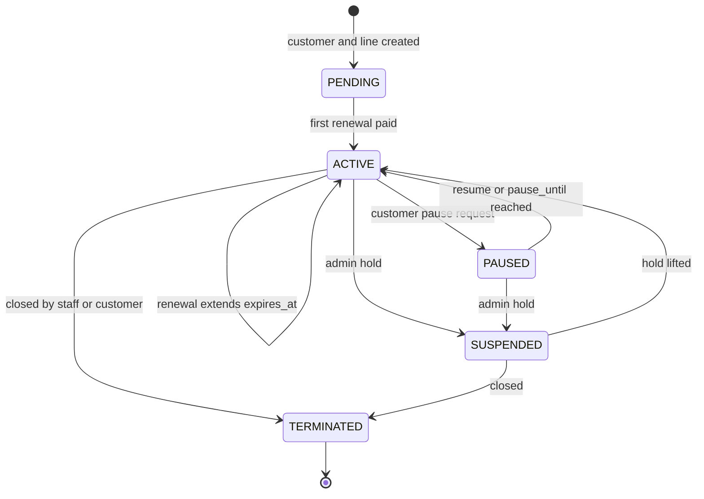

# 04 · Subscription lifecycle

Store only the states people set by hand; derive everything else from dates. RADIUS evaluates the dates itself at every login, so a stuck job can never leave an unpaid user online or a paid user offline.

## States

| State | Stored or derived | Meaning | Access profile |
|---|---|---|---|
| `PENDING` | Stored | Signed up, awaiting installation or first payment | `REJECT` |
| `ACTIVE` | Stored | Service in force; access depends on `expires_at` and grace | see below |
| `EXPIRING` | Derived: `expires_at` within 3 days | Reminder window | `FULL` |
| `GRACE` | Derived: past `expires_at`, inside `grace_days` | Final warnings | `FULL`, or `THROTTLED` when the tenant's `grace_mode` is `THROTTLED` |
| `RESTRICTED` | Derived: past grace | Unpaid | `RESTRICTED`: walled garden with portal and pay page only |
| `PAUSED` | Stored | Customer-requested pause; the expiry clock is frozen | `RESTRICTED` |
| `SUSPENDED` | Stored | Admin hold for fraud, abuse or equipment recovery | `REJECT` |
| `TERMINATED` | Stored | Account closed | removed from RADIUS |

## Stored-state transitions



Every transition writes an audit row and publishes `SubscriptionStateChanged` with a cause, which the network module turns into a CoA or Disconnect. The cause `AUTO_RESUME_RECORDED` (a job recording a resume the RADIUS view already applied at `pause_until`) needs neither: the customer's session is already on the new profile.

Staff transitions (pause, resume, suspend, lift, terminate) change access, so the API requires an `Idempotency-Key` on each and replays the original response for a repeated key. Renewal has no endpoint: it happens when money reaches the wallet (or through a wallet adjustment with a reason), charging through the billing module's wallet lock so one payment never renews two lines.

## How access is decided

The access profile is computed from the current time, not stored:

```
if state in (PENDING, SUSPENDED, TERMINATED):      REJECT
elif state == PAUSED:                               RESTRICTED
elif now <  expires_at:                             FULL
elif now <  expires_at + grace_days:                FULL or THROTTLED (tenant grace_mode)
else:                                               RESTRICTED
```

The same logic lives in two places that must agree: the `v_radius_auth` SQL view that FreeRADIUS reads, and the `AccessPolicy` class in the `subscriptions` module. A test asserts they return the same profile for the same inputs.

## Enforcement

1. **At login.** FreeRADIUS runs the profile logic inside its SQL query and returns the matching reply attributes (speed, pool, address list).
2. **Session-Timeout.** Every accepted login carries `Session-Timeout` = seconds until the next profile change (expiry if grace is throttled, otherwise grace end), capped at 24 hours. Sessions end on time and log back in under the new profile with no job involved; the cap means a missed CoA self-heals within a day.
3. **CoA for mid-session changes.** Payment, package change, pause, suspension and termination send a CoA or Disconnect to the router immediately. The router re-authenticates the customer and gets the new profile within seconds.
4. **The scheduler** runs reminders, dashboard counts, postpaid charges and fair-use checks. Access never depends on it.

## Renewal rules

- A renewal needs wallet balance ≥ package price (or a `PRO_RATA_DAYS` tenant rule, see [05](05-billing-and-payments.md)).
- **Early payment** extends from the current `expires_at`; no days are lost.
- **Lapsed account** (past grace) renews from the moment of payment.
- The clock time of `expires_at` is preserved across renewals, so a customer who activated at 14:30 always expires at 14:30 local time.
- `grace_days` is copied onto the subscription at each renewal so a policy change does not shorten a cycle already paid for.
- A `pending_package_id` is applied at renewal: the new package's price is charged and its speed takes effect.

## Pause

- Only an `ACTIVE` subscription with time remaining can be paused; maximum length is a tenant setting (default 30 days).
- `paused_at` is recorded. On resume, `expires_at += now - paused_at`, so paid days are returned.
- A paused line is `RESTRICTED`, not rejected, so the customer can still reach the portal to resume; its `Session-Timeout` runs to `pause_until`.
- Reaching `pause_until` resumes automatically without waiting for any job: from that instant the RADIUS view (and `AccessPolicy`) evaluate the line as `ACTIVE` with `expires_at + (pause_until - paused_at)`. The hourly job later records the same shift.
- Suspending a paused line first returns the paused days, then suspends.

## Suspension and termination

- `SUSPENDED` is an admin action with a reason; access is `REJECT`; the router drops the session at once. Lifting the hold re-evaluates dates: a subscription that expired during the hold comes back as `RESTRICTED`, not `FULL`.
- `TERMINATED` revokes the PPPoE password (RADIUS rejects it with "Account terminated") and frees the static IP; the customer, ledger and accounting history remain for records and lawful requests. Any wallet balance is settled by refund or credit note.

## Reminders

Templates and timing are per tenant. Defaults:

| Event key | When | Example |
|---|---|---|
| `EXPIRING_3D` | 3 days before `expires_at` | "Hi Mary, your Home Plus internet expires on 17 Nov. Pay KES 2,500 to Paybill 123456, account CB001238." |
| `EXPIRING_1D` | 1 day before | "Your internet expires tomorrow." |
| `DUE_TODAY` | On `expires_at` | "Your internet of KES 2,500 is due today." |
| `GRACE_STARTED` | At `expires_at` when grace > 0 | "Your internet has expired. You have 2 days before service is restricted." |
| `RESTRICTED` | At grace end | "Your internet is restricted. Pay to restore instantly." |
| `PAYMENT_RECEIVED` (one per payment) | After the renewal the payment caused is decided | "KES 2,500 received (CB-R000123). Home Plus renewed until 17 Nov. Thank you, Mary." Variants below. |
| `RESTORED` | A variant of `PAYMENT_RECEIVED`, not a second SMS | "... renewed until 17 Nov. Internet is back within a minute; if not, restart your router." |

**The payment message.** One SMS per payment (dedupe key: the payment ID), sent after the renewal it caused is decided, so it states the amount, the receipt number and what happened. Variants: renewed ("renewed until 17 Nov"); restored (the same, plus "Internet is back within a minute; if not, restart your router", because it goes out before the router's CoA result is known); first activation; several lines renewed by one payment (each listed with its new expiry); partial (the amount still due and how to pay); credit kept (no line due); postpaid (balance due, once postpaid billing exists). A payment whose reference was not recognised gets a reply only when Daraja sent the payer's number unmasked; it asks the payer to use their customer number. Staff adjustments send no "received" message. Reminders for a line whose wallet already covers the next cycle say it renews automatically.

**Templates and cost.** Every default fits one GSM-7 SMS (160 characters) with realistic values. Tenants may reword any template; the editor shows the rendered sample and the number of SMS parts (GSM-7: 160, then 153 per part; any other character switches to UCS-2: 70, then 67), so a change that doubles the bill is visible. Placeholders come from a fixed list with no secrets (M3).

**Delivery (Africa's Talking).** Each tenant uses its own Africa's Talking account, API key and registered sender ID; recipients are always in E.164.
- Sent: `100`, `101`, `102`.
- Failed for good, never retried, the number flagged for staff: `403` invalid number, `404` unsupported number, `406` blacklisted.
- The tenant's problem, held and retried hourly while tenant staff and the platform are alerted: `405` insufficient credit, `402` sender ID refused, HTTP 401 API key refused. The alert clears on the next successful send.
- Anything else (server errors, timeouts): retried after 1, 5 and 30 minutes, then dead-lettered and alerted.
- Delivery reports: `Success` is delivered; `Failed` and `Rejected` are failed with the reason kept; `Buffered` leaves the message sent; a report for an unknown message is dropped. The report URL carries a secret token (Africa's Talking publishes no fixed source addresses).

Each notification has a `dedupe_key` of event, subscription and `expires_at`, so a rerun of the reminder job never sends a duplicate. The subscriptions module raises each due reminder once as a `SubscriptionReminderDue` event (recorded per dedupe key in `subscriptions_reminder`); the notifications module renders and sends it. Day counts (3 days, 1 day, due today) use the tenant's local dates; a window the job missed is skipped, and `RESTRICTED` is raised only in the first day after grace. Reminders are evaluated hourly in the tenant's time zone and sent in a sending window (default 07:00 to 21:00) except `PAYMENT_RECEIVED` and `RESTORED`, which go out immediately.

### SMS sandbox round-trip

Request shapes and the answer-to-behaviour mapping are pinned by tests against a fake Africa's Talking. To confirm against the sandbox: create a sandbox app and a sender ID, open a number in the simulator, start a tunnel to Caddy, set `AT_SANDBOX_API_KEY`, `AT_SANDBOX_SENDER_ID`, `AT_SANDBOX_TEST_NUMBER` and `CALLBACK_BASE_URL` in `infra/.env`, set the delivery report URL that the script prints in the sandbox dashboard, and run `infra\scripts\at-sandbox.ps1` (or `.sh`). It records a cash payment for CB000001 and waits for the SMS to be delivered.

## Grace policy

- Set per tenant (`default_grace_days`, `grace_mode`) and overridable per package.
- Prepaid packages default to 0 grace days; postpaid home packages typically get 2.
- `THROTTLED` grace runs the customer at the package's throttle speed during grace, which nudges payment without cutting the household off.
